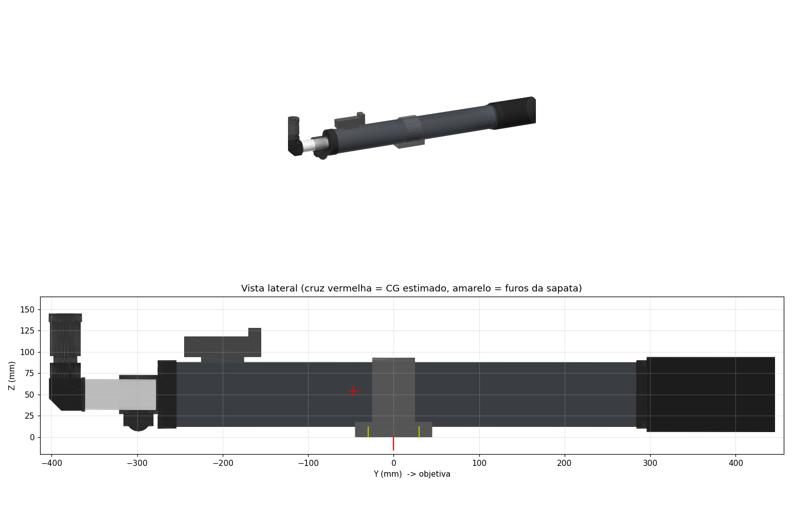

# Greika 70070: modelo APROXIMADO do tubo óptico

Refrator de 70 mm com focal de 700 mm. **Nenhuma medida foi conferida no telescópio real.** Elas foram estimadas pela foto e por refratores 70/700 do mesmo projeto. Serve para estudar a montagem (folgas, curso, balanceamento), mas **não** use para furar ou imprimir peças que dependam das medidas reais antes de conferir.

## Arquivos
- `STEP/GREIKA_70070.step`: conjunto com 11 sólidos (tubo, células, objetiva, para-sol, sapata, focalizador, tubo de foco, diagonal, ocular, buscador).
- `GREIKA_70070.FCStd`: o mesmo conjunto, dentro de um `App::Part`.
- `scripts/build_ota.py`: gera tudo. Os parâmetros ficam no topo. Rodar com:
  `"C:\Program Files\FreeCAD 1.0\bin\freecadcmd.exe" scripts\build_ota.py`
  (com `PREVIEW=caminho.png` ele também gera a imagem de conferência)

## Sistema de coordenadas
É o mesmo do `OTA_TUBO` de `MONTAGEM_EQ/build_eq.py`:
- **Y** é o eixo óptico, e **+Y** aponta para a objetiva.
- **Z** aponta para cima. **Z = 0** é a face de baixo da sapata de fixação.
- A **origem** fica no meio dos 2 furos da sapata. O eixo óptico está a **50 mm** da face da sapata.

## Valores estimados (o que medir)
| Parâmetro | Valor usado | Como medir |
|---|---|---|
| `TUBO_D` | 76 mm | diâmetro externo do tubo |
| `TUBO_L` | 560 mm | do fim da célula traseira até a célula da objetiva |
| `PARASOL_D` / `PARASOL_L` | 88 / 150 mm | diâmetro e comprimento do para-sol |
| `SAPATA_DE_TRAS` | 270 mm | do fim do tubo (lado do focalizador) até o centro da sapata |
| `SAPATA_L` × `SAPATA_W` / `SAPATA_H` | 90 × 40 / 12 mm | tamanho da sapata e distância da face dela até o tubo |
| **`FURO_DIST`** | **60 mm** | **distância entre os 2 furos de fixação. É o que falta para o adaptador da cauda de andorinha** |
| `FURO_D` | 5 mm (para M6) | rosca dos furos: M6 ou 1/4"-20 |
| `FOC_D` / `FOC_L` / `FOC_CURSO` | 46 / 45 / 40 mm | focalizador e quanto o tubo de foco sai no ponto de foco |
| `BUSCADOR_DE_TRAS` | 70 mm | posição do red dot |
| `MASSA` | 1,50 kg no total | pese o tubo com diagonal e ocular |

## Resultado (com os valores estimados)
- Comprimento total: **850 mm** (da diagonal até a boca do para-sol). Altura: 145 mm (até o topo da ocular).
- **CG estimado 47 mm atrás do centro da sapata**, para o lado do focalizador, por causa do focalizador, da diagonal e da ocular. Na sela Vixen, deslize o trilho uns 5 cm para trás para equilibrar o DEC.
- 11 sólidos válidos, sem interferências. O STEP reimporta com 11 sólidos.
