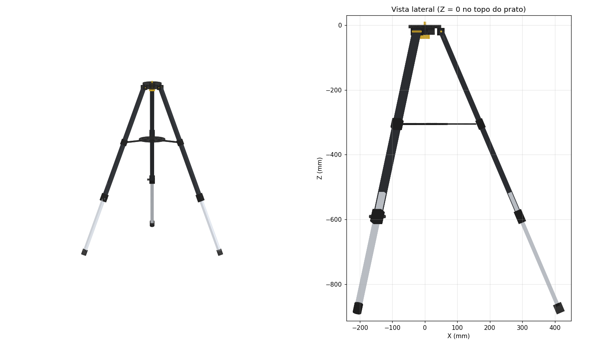

# Tripé (Greika 70070): modelo APROXIMADO

Este é só o tripé de alumínio, sem a cabeça azimutal original, com um parafuso de 1/4"-20 no prato para fixar a `BASE` da `MONTAGEM_EQ`. **Nenhuma medida foi conferida no tripé real**: todas foram estimadas pela foto. Serve para estudar o conjunto (altura, estabilidade, folga do tubo com as pernas), mas não para fabricar peças antes de conferir.

## Arquivos
- `STEP/TRIPE.step`: 24 sólidos. São a cabeça (prato, corpo e orelhas), o parafuso com manopla e a bandeja. Para cada uma das 3 pernas: seção externa, seção interna, trava, ponteira, abraçadeira, pino e braço do espalhador.
- `TRIPE.FCStd`: o mesmo conjunto, dentro de um `App::Part`.
- `scripts/build_tripe.py`: gera tudo. Os parâmetros ficam no topo. Rodar com:
  `"C:\Program Files\FreeCAD 1.0\bin\freecadcmd.exe" scripts\build_tripe.py`
  (com `PREVIEW=caminho.png` ele também gera a imagem de conferência)

## Sistema de coordenadas
- **Z = 0** é a face de cima do prato, onde apoia a face de baixo da `BASE` (que também está em Z = 0 no `build_eq.py`).
- A **origem** fica no centro do parafuso. A perna 1 aponta para +X e as outras estão a 120° e 240°.

## Parafuso
- 1/4"-20 UNC, modelado como um cilindro de Ø6,35 mm (sem a rosca). Ele sai **10 mm** acima do prato (`PARAF_ACIMA`). A porca da BASE tem 6,5 mm de altura e o furo continua acima dela, então sobra folga.
- Ele aperta pela manopla serrilhada de Ø30, embaixo do corpo central.

## Valores estimados (o que medir)
| Parâmetro | Valor usado | O que é |
|---|---|---|
| `PRATO_D` | 100 mm | diâmetro do prato de cima |
| `ABERTURA` | 23° | ângulo de cada perna em relação à vertical |
| `PERNA_RAD` × `PERNA_TAN` | 16 × 22 mm | seção externa da perna |
| `INT_RAD` × `INT_TAN` | 12 × 18 mm | seção interna (a parte prateada) |
| `PERNA_L` | 620 mm | do pino até a trava |
| `EXTENSAO` | 300 mm | quanto a seção interna está para fora (0 = tripé fechado) |
| `ESPAL_S` | 310 mm | onde o espalhador prende, medido ao longo da perna a partir do pino |
| `BANDEJA_D` | 140 mm | bandeja com 3 furos para oculares de 1,25" |

## Resultado (com os valores estimados)
- O prato fica a **892 mm** do chão. Os pés ficam num círculo de raio **418 mm**.
- O espalhador fica 305 mm abaixo do prato.
- Os 24 sólidos são válidos e não se sobrepõem. O STEP reimporta com 24 sólidos.
- Para outra altura, mude `EXTENSAO` (de 0 até ~`PERNA_L − SOBREPOSICAO`) e rode de novo.
